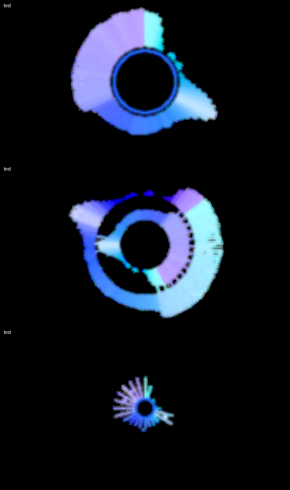

# 音频频谱视频生成器

根据音频频谱离线生成动感视频，可作为音乐 MV 素材。支持真正透明背景输出、可选嵌入原音频，全程后台渲染，无需录屏。

同时提供 **Windows 桌面版**（Python）与 **Android 原生版**（Kotlin）两套实现。



## 功能特性

- **8 种视觉效果**：底部频谱条、中央镜像扩散、环形频谱、双环旋转、螺旋星轨、波形脉冲、能量隧道、粒子爆破
- **7 套配色**：霓虹青紫、全彩循环、烈焰金红、极光青绿、冰蓝纯白、纯白、紫蓝渐变
- **参数可调**：分辨率、帧率、频谱柱数（32/64/96/128/192）、发光强度（0/0.5/1/1.5/2）、FFT 窗口（覆盖 20Hz–20kHz）
- **透明视频**：MOV ProRes 4444、WebM VP9 真透明；MP4 提供黑幕、绿幕、黑白遮罩三种方案
- **自适应并行渲染**：按 CPU 核心数自动选择进程数，帧保序写入，界面实时显示进度并支持取消
- **示例图库**：8 种效果 × 4 类参数的示例图（共 275 个文件），界面内可随参数实时预览并打开图库

## 快速开始（Windows 桌面版）

本仓库不包含打包好的 exe（其中会带有 GPLv3 授权的 ffmpeg 二进制）。请从源码运行，或自行打包后仅本地使用。

### 源码运行

需要 Python 3.10+（本机验证为 3.12）：

```bash
pip install -r requirements.txt
python -m audio_visualizer.gui          # 启动图形界面
```

ffmpeg 由 `imageio-ffmpeg` 在安装时提供；如需改用自己安装的 ffmpeg，可设置环境变量 `FFMPEG_PATH` 指向其可执行文件。

### 命令行模式

```bash
python -m audio_visualizer.cli 音乐.mp3 --mode mirror --format mov
python -m audio_visualizer.cli 音乐.wav --preset fast --format webm --no-audio
python -m audio_visualizer.cli --list                     # 列出所有效果与格式
```

常用参数：`--mode`、`--theme`、`--format`、`--preset`、`--width/--height`、`--fps`、`--bars`、`--glow`、`--fft`、`--crf`、`--workers`（0=自动）、`--no-audio`、`--preview SEC`（只渲染一帧 PNG）。

画质预设：`quality`（1080p/30fps）、`balanced`（720p/30fps）、`fast`（720p/24fps/无辉光）、`mobile`（640×640/24fps）。

### 重新打包 exe（可选，仅建议本地使用）

安装 PyInstaller 后双击 `重新打包.bat`，产物在 `dist/`（已被 Git 忽略）。如需对外分发该 exe，请先阅读 [THIRD_PARTY_LICENSES.md](THIRD_PARTY_LICENSES.md) 并自行履行 ffmpeg 的 GPLv3 义务。

## Android 原生版

完整 Kotlin 工程位于 `AndroidVisualizer/`，目标 minSdk 26 / targetSdk 34。用 Android Studio 打开并同步 Gradle，连接真机或启动模拟器后运行；`Build > Build Bundle(s)/APK(s) > Build APK(s)` 可生成安装包。详见 [AndroidVisualizer/README.md](AndroidVisualizer/README.md)。

平台限制：安卓编码器无 alpha 通道，不支持 MOV/WebM 真透明，改用 MP4 + 遮罩方案；手机端为单线程渲染。

## 目录结构

```
.
├── README.md                 本说明
├── THIRD_PARTY_LICENSES.md   第三方组件与许可说明
├── .gitignore                Git 忽略规则
├── requirements.txt          Python 依赖
├── 启动可视化工具.bat         一键启动 GUI（自动安装依赖）
├── 重新打包.bat               一键重新打包 exe
├── build_entry.py            打包入口
├── audio_visualizer.spec     PyInstaller 配置
├── audio_visualizer/         桌面版源码（分析/渲染/编码/GUI/CLI）
├── AndroidVisualizer/        Android 原生版工程
├── 示例图库/                 参数示例图、总览图与效果预览（GUI 与打包均依赖，勿移动）
└── dist/                     本地打包产物（Git 忽略，不随仓库分发）
```

## 透明通道说明

H.264 MP4 本身不支持 alpha。如需真正透明：

- `mov`：ProRes 4444，真透明，剪辑软件兼容性最好，文件极大
- `webm`：VP9，真透明，体积小，编码较慢
- `mp4-matte`：同时输出主视频与黑白遮罩 MP4，在剪辑软件中用亮度键还原透明

## 许可证

本仓库内的自有代码仅供个人学习与素材制作使用；第三方依赖按其各自许可证分发，详见 [THIRD_PARTY_LICENSES.md](THIRD_PARTY_LICENSES.md)。

本仓库不随附任何 ffmpeg 二进制。程序通过命令行与管道调用 ffmpeg，属于独立程序之间的聚合，不会因此使本项目源码受 GPL 传染。但若对外分发包含 ffmpeg 的打包 exe，分发方须自行履行 GPLv3 义务（附许可证全文、提供源码或书面要约、保留声明）；H.264/H.265 的专利授权亦需按实际用途另行评估。
